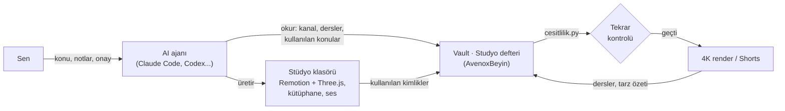

# Mimari

- **Vault (AvenoxBeyin):** Hafıza. Düz Markdown; Obsidian'da açılır, elle düzeltilebilir, başka bir
  AI istemcisi de aynı notları okur.
- **Stüdyo klasörü:** Ağır her şey: Remotion projesi, kütüphane kodu ve önizlemeleri, ses,
  render'lar. Vault'u şişirmez.
- **Skill (`whatif-studyo`):** Ajanın ne zaman okuyup ne zaman yazacağını ve üretim hattını
  anlatır. Kanala özel hiçbir şey taşımaz; her şeyi defterden öğrenir.

## Akış

1. **Başlarken:** `Kanal.md`, `Acik-Isler.md`, `Kullanilan-Konular.md` ve son dersler okunur.
2. **Üretirken:** `URETIM.md` adımları; yalnız senaryo, kadro ve taslakta onay istenir.
3. **Render'dan önce:** `KALITE.md` listesi ve `cesitlilik.py`.
4. **Bitince:** Tarz özeti yeniden yazılır, bölüm notu doldurulur, kimlikler günlüğe işlenir.
